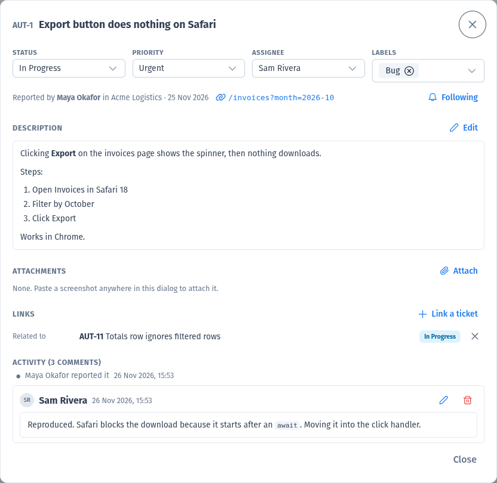
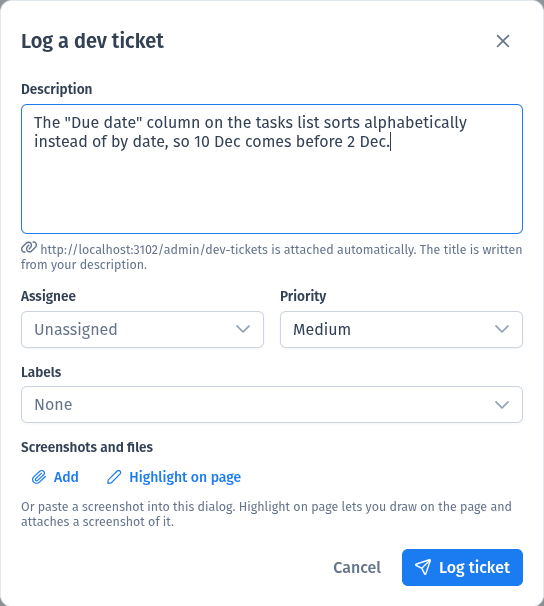
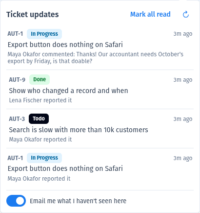
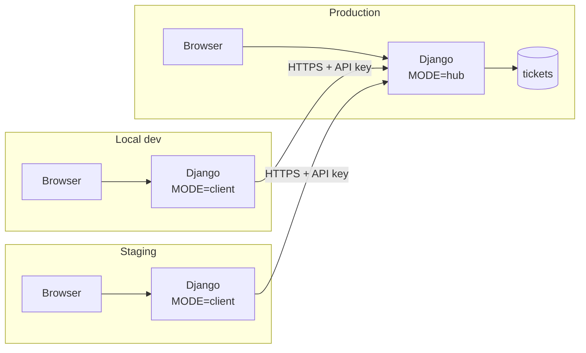

<div align="center">

# Dev Tickets

**An issue tracker that lives inside your app.**
Your team reports a bug from the page it happened on, and it lands on a kanban board in the same app.

A Django app and a Nuxt layer · one versioned release for both


</div>

---

> **Status: being extracted.** Dev Tickets runs in production inside
> [AutoRoster](https://autoroster.co.za), where it replaced Linear in November 2026. This
> repository is where it becomes a standalone package. The interfaces below describe 1.0.
> Until `v1.0.0` is tagged, settings and names may still change.

## Why

External trackers have two costs that add up. First, every tester needs a paid seat,
so reports end up filed by one shared account and nobody can tell who reported what.
Second, a report written outside the app loses where it came from: which page, which
customer, and what was on the screen.

Dev Tickets stays inside the app:

- **Report from where you are.** A floating button on every page opens a short form. The
  page URL and the customer you are working in are attached automatically. Paste a
  screenshot, or draw on the live page and attach that.
- **Everyone is a real person.** The reporter, assignee and commenters are your app's own
  users, so the person who reported a bug is the one told when it is fixed.
- **No seats and no sync.** The tickets are rows in your own database, or in one hub that
  all your environments share (see below).

## Features

| Feature | What it does |
| --- | --- |
| **Kanban board** | Triage → Backlog → Todo → In Progress → Done; Canceled and Duplicate sit off the board. Drag cards between lanes. Search, filter by reporter / assignee / priority / label, and choose the sort order. |
| **Deep links** | The open ticket is part of the URL (`/admin/dev-tickets/APP-12`), so a link pastes straight into chat. |
| **Report widget** | A floating button on every page. Records the page URL and the context you were working in, and takes pasted screenshots and files. |
| **Highlight on page** | Draw arrows, boxes, circles or freehand on the live page. A screenshot of the marked-up page is attached to the ticket. |
| **AI titles (optional)** | Write a description and the title is written for you. Plug in any model; without one, the first words of the description become the title. |
| **Markdown everywhere** | Descriptions and comments use a formatting toolbar, and are rendered and sanitised on the server. |
| **Links between tickets** | *related*, *blocks* / *blocked by*, *duplicate of*. |
| **Full history** | Every change is recorded as an event: state, priority, assignee, labels, title, description, comments. |
| **Notifications** | A bell in your header. Reporter, assignee and commenters follow a ticket automatically, and anyone can follow or unfollow. Each person can switch email on or off. |
| **Email digest** | Anything still unread after 2 minutes goes out as one email, so someone with the app open gets no mail at all. A run of changes arrives as one message, not ten. |
| **Attachments** | Images and PDFs open inline; anything else downloads, so an uploaded HTML or SVG file can never run script on your domain. Up to 15 MB each. |
| **AI assistant tools (MCP)** | `tickets_list`, `tickets_get`, `tickets_create`, `tickets_update`, `tickets_comment`, `tickets_link`, `tickets_unlink`, `tickets_team`. Claude, ChatGPT and other assistants can triage and update tickets. |
| **Shared across environments** | Run one *hub*, and dev, staging and production all file into the same board over an API (see [One board for every environment](#one-board-for-every-environment)). |

## Screenshots

<table>
<tr>
<td width="60%"><br><sub>A ticket: status, priority, assignee and labels edited in place. The reporter, page and context come from the widget.</sub></td>
<td width="40%"><br><sub>The report widget: just a description. The page is attached and the title is written for you.</sub><br><br><br><sub>The bell: what changed on tickets you follow.</sub></td>
</tr>
<tr>
<td colspan="2"><br><sub>Highlight on page: mark the problem on the live page. A screenshot of it is attached to the ticket.</sub></td>
</tr>
</table>

## What's in the box

```
dev-tickets/
├── python/          django-dev-tickets   → pip       (import dev_tickets)
├── nuxt/            nuxt-dev-tickets     → npm       (a Nuxt layer)
├── playground/      a minimal Django + Nuxt app for development and screenshots
└── docs/
```

Both packages are released together under one version number. `django-dev-tickets 1.4.2`
and `nuxt-dev-tickets 1.4.2` are always built to work together.

**Requirements:** Python 3.12+, Django 5.0+, Strawberry GraphQL 0.240+ · Node 22+,
Nuxt 4, PrimeVue 4.

---

## Quick start

### 1. Backend

```bash
pip install django-dev-tickets
```

```python
# settings.py
INSTALLED_APPS = [
    # ...
    "dev_tickets",
]

DEV_TICKETS = {
    "PREFIX": "APP",                      # tickets are APP-1, APP-2, ...
    "BOARD_URL": "https://app.example.com/admin/dev-tickets",
}
```

```python
# urls.py
from django.urls import include, path

urlpatterns = [
    # ...
    path("", include("dev_tickets.urls")),   # /devtickets/graphql/ and /devtickets-files/
]
```

```bash
python manage.py migrate dev_tickets
```

Send the email digest once a minute, from cron, a systemd timer or Celery beat:

```bash
python manage.py devtickets_notify
```

### 2. Frontend

```bash
npm install nuxt-dev-tickets
```

```ts
// nuxt.config.ts
export default defineNuxtConfig({
  extends: ['nuxt-dev-tickets'],
  runtimeConfig: {
    public: {
      devTickets: {
        endpoint: 'http://localhost:8000/devtickets/graphql/',
      },
    },
  },
})
```

Pick the board's URL yourself by adding a page:

```vue
<!-- pages/admin/dev-tickets/[[id]].vue -->
<template>
  <DevTicketBoard base-path="/admin/dev-tickets" />
</template>
```

Then put the widget and the bell where they belong in your layout:

```vue
<!-- layouts/default.vue -->
<template>
  <header>
    <!-- ... -->
    <DevTicketBell />
  </header>
  <slot />
  <DevTicketWidget />
</template>
```

Both hide themselves for users who may not use Dev Tickets. That's it.

### 3. Tell it who your users are

The package asks your app three questions, each as a dotted path to a function. All three
have sensible defaults:

```python
DEV_TICKETS = {
    # Who may see the board, file tickets and be assigned. Default: is_superuser.
    "CAN_ACCESS": "myapp.devtickets.can_access",          # (user) -> bool

    # Shown on a ticket as "Reported by Maya in <context>". Default: none.
    "CONTEXT_LABEL": "myapp.devtickets.current_company",  # (request) -> str

    # Writes a title from the description. Default: the first line.
    "TITLE_GENERATOR": "myapp.devtickets.ai_title",       # (description, request) -> str
}
```

```python
# myapp/devtickets.py
def can_access(user) -> bool:
    return user.is_active and user.groups.filter(name="Product team").exists()

def current_company(request) -> str:
    return request.user.company.name if request.user.is_authenticated else ""
```

---

## Configuration reference

All settings live in one `DEV_TICKETS` dict.

| Setting | Default | What it does |
| --- | --- | --- |
| `MODE` | `"standalone"` | `standalone`, `hub` or `client`. See [below](#one-board-for-every-environment). |
| `PREFIX` | `"DEV"` | Identifier prefix: `DEV-12`. |
| `BOARD_URL` | `""` | Absolute URL of the board, used for links in emails. |
| `CAN_ACCESS` | superusers | `(user) -> bool`. Who may use it, and who can hold a ticket. |
| `CONTEXT_LABEL` | none | `(request) -> str`. The tenant, company or workspace a ticket was filed from. |
| `TITLE_GENERATOR` | first line | `(description, request) -> str`. Raise or return `""` to fall back. |
| `SEND_MAIL` | Django `send_mail` | `(subject, text, html, to) -> None`. Plug in your own templated mailer. |
| `EMAIL_AFTER` | `120` | Seconds a notification must stay unread before it is emailed. |
| `STORAGE` | `"default"` | Name of the `STORAGES` entry used for attachments. |
| `MAX_ATTACHMENT_MB` | `15` | |
| `DEFAULT_ASSIGNEE` | none | Username or email that new tickets are assigned to. |
| `HUB_URL` | — | `client` mode: the hub's base URL. |
| `HUB_API_KEY` | — | `client` mode: this environment's key. Keep it in the environment, never in git. |
| `SOURCE` | — | `client` mode: shown on each ticket, e.g. `"staging"`. |

Frontend (`runtimeConfig.public.devTickets`):

| Key | What it does |
| --- | --- |
| `endpoint` | Your backend's `/devtickets/graphql/`. In every mode, the browser talks only to its own backend. |
| `csrfUrl` | Optional. A URL to `GET` once so Django issues the CSRF cookie. |

---

## One board for every environment

A standalone install keeps tickets in each environment's own database, so a bug filed on
staging is invisible from production, and a database restore from production onto
staging overwrites staging's tickets. Most teams want **one board**, wherever a ticket
was filed from.

Dev Tickets does this over an **API, not a shared database connection**. One deployment is
the **hub** and owns the tickets. Every other environment runs as a **client** and has no
ticket tables at all.



**Why an API and not a second `DATABASES` entry:**

- **Users differ in each environment.** User 7 on staging is not user 7 in production, so a
  foreign key cannot cross environments. The hub knows people by **email** and keeps its
  own small table of them (name, email, avatar). A client says who is acting, and the hub
  matches on email.
- **No database credentials leave the hub.** A laptop holds an API key that can be revoked
  on its own, not a password for the production database.
- **Schema changes happen in one place.** Only the hub runs migrations. A client and a hub
  on different minor versions can still talk to each other, which is not true of two
  Django processes migrating one database.
- **Email goes out once.** Only the hub sends digests, so three environments never send
  the same notification three times.
- **Attachments live in one place.** A client streams uploads through to the hub, so a
  screenshot filed from a laptop can still be opened from production.

### Setting it up

**On the hub** (usually production, or a small deployment of its own):

```python
DEV_TICKETS = {
    "MODE": "hub",
    "PREFIX": "APP",
    "BOARD_URL": "https://app.example.com/admin/dev-tickets",
}
```

```bash
python manage.py devtickets_client add staging     # prints the key once
python manage.py devtickets_client add dev-johan
python manage.py devtickets_client list
python manage.py devtickets_client revoke dev-johan
```

**On each client:**

```python
DEV_TICKETS = {
    "MODE": "client",
    "HUB_URL": "https://app.example.com",
    "HUB_API_KEY": env("DEV_TICKETS_HUB_KEY"),
    "SOURCE": "staging",
}
```

Nothing changes in the frontend. The browser keeps talking to its own backend with its
own session cookie. In client mode, that backend checks `CAN_ACCESS` against its own
user, then forwards the request to the hub with its key and the user's identity. The
API key never reaches a browser, and no CORS or cross-site cookies are involved.

### One hub for several apps

A hub can serve more than one product. Each client key belongs to a **project** with its
own prefix and board, so AutoRoster's dev, staging and production file `AUT-` tickets
while a second app files `MHQ-` tickets on its own board, under one login and one bell.

```bash
python manage.py devtickets_client add staging --project AUT
python manage.py devtickets_client add production --project MHQ
```

### What a client key can do

A client key can **act as any person it names**: the hub trusts the client to have
checked who is signed in. Treat it like a database password:

- Give **every environment, and every developer's laptop, its own key**, so revoking
  one affects nobody else.
- Every ticket, comment and change records the **source** that made it.
- A hub can set a key to read-only (`--read-only`). This suits a demo environment.

### The hub API

The packages use it internally, but it is a plain, versioned JSON API, so other tools
can use it too.

```
Authorization: Bearer <client key>
X-Dev-Tickets-Actor: {"email": "maya@example.com", "name": "Maya Okafor", "avatar": "https://…"}

GET    /devtickets/api/v1/board
GET    /devtickets/api/v1/tickets/APP-12
POST   /devtickets/api/v1/tickets
PATCH  /devtickets/api/v1/tickets/APP-12
POST   /devtickets/api/v1/tickets/APP-12/comments
POST   /devtickets/api/v1/tickets/APP-12/attachments
POST   /devtickets/api/v1/tickets/APP-12/links
GET    /devtickets/api/v1/notifications
POST   /devtickets/api/v1/notifications/read
GET    /devtickets/api/v1/team
```

Breaking changes get a new path (`/api/v2/`). A hub serves the previous version for at
least one major release, so you can upgrade the hub first and the clients afterwards.

---

## AI assistants (MCP)

```bash
pip install "django-dev-tickets[mcp]"
```

The tools are plain functions over the same service layer the UI uses, so every change an
assistant makes is validated, recorded in the history and notified exactly as if a person
had made it. Register them with the MCP server you already run:

```python
from dev_tickets.mcp import register_tools

register_tools(my_mcp_server, prefix="tickets_")
```

| Tool | What it does |
| --- | --- |
| `tickets_team` | Who can hold a ticket, and the states, priorities and labels. |
| `tickets_list` | Search and filter. |
| `tickets_get` | One ticket in full: description, comments, history, links, followers. |
| `tickets_create` | File a ticket. |
| `tickets_update` | State, priority, assignee, labels, title, description. |
| `tickets_comment` | Reply on a ticket. |
| `tickets_link` / `tickets_unlink` | Related, blocks, duplicate of. |

In client mode the tools call the hub like everything else, so an assistant connected to
staging sees the same board as one connected to production.

---

## Security notes

- **Access is decided by your app** (`CAN_ACCESS`), on every query, mutation, file and
  API call. Nothing is public.
- **Uploads are never trusted.** Only images and PDFs are served inline. Everything else
  is sent as a download, because an HTML or SVG file opened on your domain would run
  script with the viewer's session.
- **Markdown is sanitised on the server** ([nh3](https://github.com/messense/nh3)) before
  it is stored or emailed.
- **Each change is one transaction** with its history event, so the board and the
  history cannot disagree.
- **Proxy prefixes.** If a reverse proxy sends only some paths to Django, add
  `/devtickets/` and `/devtickets-files/` to it. If you don't, uploads go to your frontend
  server and fail with an error that doesn't mention Dev Tickets.

---

## Versioning and updates

Dev Tickets follows [Semantic Versioning](https://semver.org). One tag releases both
packages:

| Change | Version | What you do |
| --- | --- | --- |
| Bug fix | `1.4.1 → 1.4.2` | Update. |
| New feature, additive migration, new optional setting | `1.4 → 1.5` | Update and run `migrate`. |
| Breaking setting, removed API, a migration that rewrites data | `1 → 2` | Read [CHANGELOG.md](CHANGELOG.md) first. |

Within a major version, migrations only add things, so a hub can run ahead of its
clients.

### Getting every update into every app

Let a bot open the upgrade PR in each app that uses Dev Tickets, so every release reaches
all of them and each app's CI tests it before it ships. Add
[Renovate](https://docs.renovatebot.com) to each app's repository:

```json
{
  "extends": ["config:recommended"],
  "packageRules": [
    {
      "matchPackageNames": ["django-dev-tickets", "nuxt-dev-tickets"],
      "groupName": "dev-tickets",
      "automerge": false
    }
  ]
}
```

The `groupName` keeps the backend and frontend upgrade in **one PR**, so they never drift
apart. Dependabot works too, but it opens one PR per ecosystem.

Updates are deliberately not deployed without a PR: a release can carry a migration, and
a migration should go through the same review and deploy as the rest of your code.

---

## Development

```bash
git clone https://github.com/unluckynelson/dev-tickets
cd dev-tickets

# backend
cd python && python -m venv .venv && .venv/bin/pip install -e ".[dev,mcp]"
.venv/bin/pytest                                  # needs Postgres; see python/README

# frontend
cd ../nuxt && npm install && npm run lint

# both, wired together, with sample data
cd ../playground && ./run.sh                      # http://localhost:3300
```

The playground seeds the sample team and tickets shown in the screenshots above, so a
new screenshot is one command away.

### Releasing

```bash
./scripts/release.sh 1.5.0     # bumps both packages, updates CHANGELOG, tags v1.5.0
git push --follow-tags         # CI publishes to PyPI and npm
```

## Roadmap

- [ ] Extract the backend from AutoRoster into `python/`, with tests
- [ ] Extract the Nuxt layer into `nuxt/`
- [ ] Playground app
- [ ] Hub / client mode and the v1 API
- [ ] Release workflow (PyPI + npm on tag)
- [ ] AutoRoster moved onto the package: `v1.0.0`
- [ ] Projects: several apps on one hub
- [ ] Webhooks (Slack, Discord) on state changes

## License

To be decided before `v1.0.0`.
