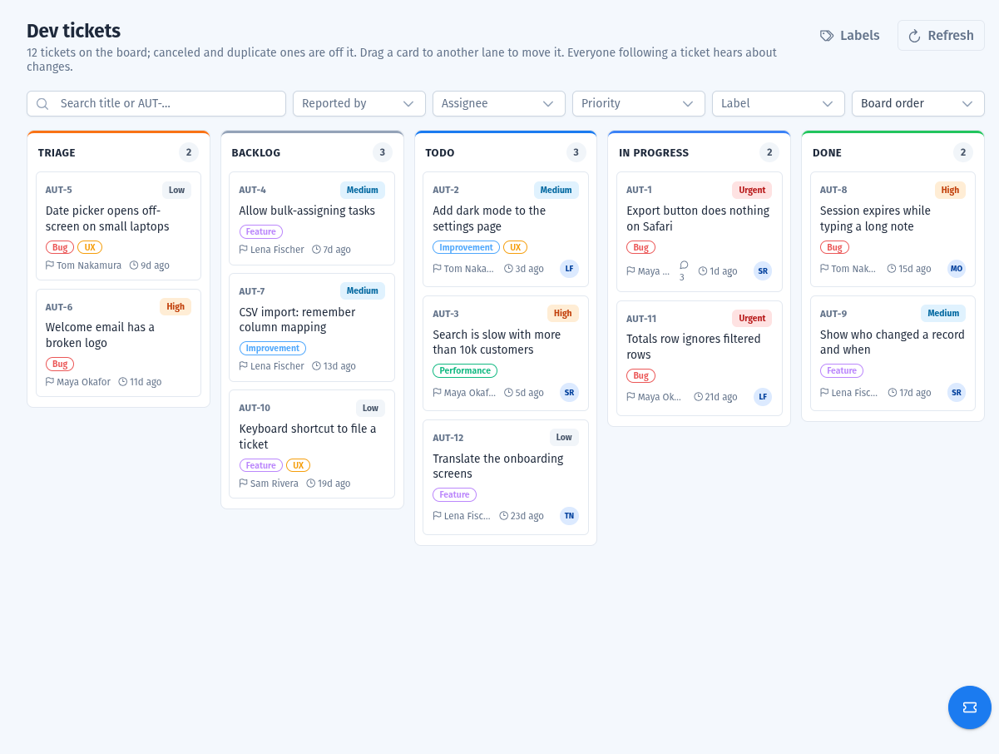
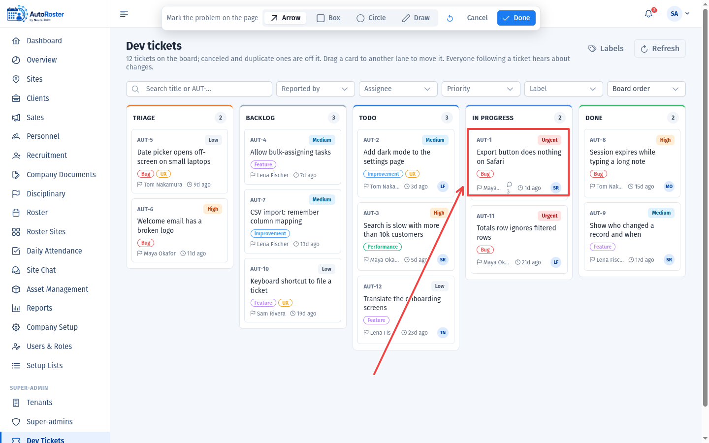
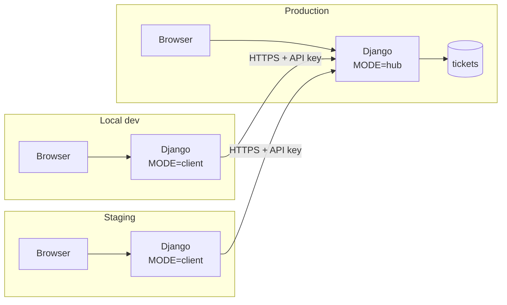

<div align="center">

# Dev Tickets

**An issue tracker that lives inside your app.**
Your team reports a bug from the page it happened on, and it lands on a kanban board in the same app.

A Django app and a Nuxt layer · one versioned release for both



</div>

---

> **Status: 0.x, pre-release.** Dev Tickets runs in production inside
> [AutoRoster](https://autoroster.co.za), where it replaced Linear in November 2026, and is
> now extracted here. Standalone, hub and client modes all work and run together in the
> [playground](#development). Nothing is on PyPI or npm until `v1.0.0`; until then,
> settings and names may still change.

## Why

External trackers have two costs that add up. First, every tester needs a paid seat,
so reports end up filed by one shared account and nobody can tell who reported what.
Second, a report written outside the app loses where it came from: which page, which
customer, and what was on the screen.

Dev Tickets stays inside the app:

- **Report from where you are.** A floating button on every page opens a short form. The
  page URL and the customer you are working in are attached automatically. Paste a
  screenshot, or draw on the live page and attach that.
- **Everyone is a real person.** The reporter, assignee and commenters are your app's own
  users, so the person who reported a bug is the one told when it is fixed.
- **No seats and no sync.** The tickets are rows in your own database, or in one hub that
  all your environments share (see below).

## Features

| Feature | What it does |
| --- | --- |
| **Kanban board** | Triage → Backlog → Todo → In Progress → Done out of the box; Canceled and Duplicate sit off the board. Drag cards between lanes. Search, filter by reporter / assignee / priority / label, and choose the sort order. |
| **Settings on the board** | A gear in the board's corner: add, rename, retype, reorder and remove lanes; edit labels; switch your email on or off; and set this install up as standalone, hub or client, including the hub's keys. See [Settings](#settings). |
| **Deep links** | The open ticket is part of the URL (`/admin/dev-tickets/APP-12`), so a link pastes straight into chat. |
| **Report widget** | A floating button on every page. Records the page URL and the context you were working in, and takes pasted screenshots and files. |
| **Highlight on page** | Draw arrows, boxes, circles or freehand on the live page. A screenshot of the marked-up page is attached to the ticket. |
| **AI titles (optional)** | Write a description and the title is written for you. Plug in any model; without one, the first words of the description become the title. |
| **Markdown everywhere** | Descriptions and comments use a formatting toolbar, and are rendered and sanitised on the server. |
| **Links between tickets** | *related*, *blocks* / *blocked by*, *duplicate of*. |
| **Full history** | Every change is recorded as an event: state, priority, assignee, labels, title, description, comments. |
| **Notifications** | A bell in your header. Reporter, assignee and commenters follow a ticket automatically, and anyone can follow or unfollow. Each person can switch email on or off. |
| **Email digest** | Anything still unread after 2 minutes goes out as one email, so someone with the app open gets no mail at all. A run of changes arrives as one message, not ten. |
| **Attachments** | Images and PDFs open inline; anything else downloads, so an uploaded HTML or SVG file can never run script on your domain. Up to 15 MB each. |
| **AI assistant tools (MCP)** | `tickets_list`, `tickets_get`, `tickets_create`, `tickets_update`, `tickets_comment`, `tickets_link`, `tickets_unlink`, `tickets_team`. Claude, ChatGPT and other assistants can triage and update tickets. |
| **Shared across environments** | Run one *hub*, and dev, staging and production all file into the same board over an API (see [One board for every environment](#one-board-for-every-environment)). |

## Screenshots

<table>
<tr>
<td width="60%"><br><sub>A ticket: status, priority, assignee and labels edited in place. The reporter, page and context come from the widget.</sub></td>
<td width="40%"><br><sub>The report widget: just a description. The page is attached and the title is written for you.</sub><br><br><br><sub>The bell: what changed on tickets you follow.</sub></td>
</tr>
<tr>
<td colspan="2"><br><sub>Highlight on page: mark the problem on the live page. A screenshot of it is attached to the ticket.</sub></td>
</tr>
</table>

## What's in the box

```
dev-tickets/
├── python/          django-dev-tickets   → pip       (import dev_tickets)
├── nuxt/            nuxt-dev-tickets     → npm       (a Nuxt layer)
├── playground/      a minimal Django + Nuxt app for development and screenshots
└── docs/
```

Both packages are released together under one version number. `django-dev-tickets 1.4.2`
and `nuxt-dev-tickets 1.4.2` are always built to work together.

**Requirements:** Python 3.10+, Django 5.1+, Strawberry GraphQL 0.240+ · Node 22+,
Nuxt 4, PrimeVue 4.

---

## Quick start

### 1. Backend

```bash
pip install django-dev-tickets
```

```python
# settings.py
INSTALLED_APPS = [
    # ...
    "dev_tickets",
]

DEV_TICKETS = {
    "PREFIX": "APP",                      # tickets are APP-1, APP-2, ...
    "BOARD_URL": "https://app.example.com/admin/dev-tickets",
}
```

```python
# urls.py
from django.urls import include, path

urlpatterns = [
    # ...
    path("", include("dev_tickets.urls")),   # /devtickets/graphql/ and /devtickets-files/
]
```

```bash
python manage.py migrate dev_tickets
```

Send the email digest once a minute, from cron, a systemd timer or Celery beat:

```bash
python manage.py devtickets_notify
```

### 2. Frontend

```bash
npm install nuxt-dev-tickets
```

```ts
// nuxt.config.ts
export default defineNuxtConfig({
  extends: ['nuxt-dev-tickets'],
  runtimeConfig: {
    public: {
      devTickets: {
        endpoint: 'http://localhost:8000/devtickets/graphql/',
      },
    },
  },
})
```

Pick the board's URL yourself by adding a page:

```vue
<!-- pages/admin/dev-tickets/[[id]].vue -->
<template>
  <DevTicketBoard base-path="/admin/dev-tickets" />
</template>
```

Then put the widget and the bell where they belong in your layout:

```vue
<!-- layouts/default.vue -->
<template>
  <header>
    <!-- ... -->
    <DevTicketBell />
  </header>
  <slot />
  <DevTicketWidget />
</template>
```

Both hide themselves for users who may not use Dev Tickets. That's it.

### 3. Tell it who your users are

The package asks your app three questions, each as a dotted path to a function. All three
have sensible defaults:

```python
DEV_TICKETS = {
    # Who may see the board, file tickets and be assigned. Default: is_superuser.
    "CAN_ACCESS": "myapp.devtickets.can_access",          # (user) -> bool

    # Shown on a ticket as "Reported by Maya in <context>". Default: none.
    "CONTEXT_LABEL": "myapp.devtickets.current_company",  # (request) -> str

    # Writes a title from the description. Default: the first line.
    "TITLE_GENERATOR": "myapp.devtickets.ai_title",       # (description, request) -> str
}
```

```python
# myapp/devtickets.py
def can_access(user) -> bool:
    return user.is_active and user.groups.filter(name="Product team").exists()

def current_company(request) -> str:
    return request.user.company.name if request.user.is_authenticated else ""
```

---

## Configuration reference

All settings live in one `DEV_TICKETS` dict.

| Setting | Default | What it does |
| --- | --- | --- |
| `MODE` | `"standalone"` | `standalone`, `hub` or `client`. See [below](#one-board-for-every-environment). |
| `PREFIX` | `"DEV"` | Identifier prefix: `DEV-12`. |
| `BOARD_URL` | `""` | Absolute URL of the board, used for links in emails. |
| `CAN_ACCESS` | active superusers | `(user) -> bool`. Who may see the board, file tickets and get notifications. |
| `CAN_CONFIGURE` | `CAN_ACCESS` | `(user) -> bool`. Who may change the connection (mode, hub, keys) in Settings. |
| `TEAM` | active superusers | `() -> QuerySet` of users. Who can be assigned a ticket. |
| `TEAM_NAME` | `"Dev"` | Shown on the board. |
| `CONTEXT_LABEL` | none | `(request) -> str`. The tenant, company or workspace a ticket was filed from. |
| `TITLE_GENERATOR` | first line | `(description, request) -> str`. Raise or return `""` to fall back. |
| `SEND_MAIL` | Django `send_mail` | `(subject, text, html, to) -> None`. Plug in your own templated mailer. |
| `EMAIL_AFTER` | `120` | Seconds a notification must stay unread before it is emailed. |
| `STORAGE` | `"default"` | Name of the `STORAGES` entry used for attachments. |
| `MAX_ATTACHMENT_MB` | `15` | |
| `DEFAULT_ASSIGNEE` | none | Username or email that new tickets are assigned to. |
| `HUB_URL` | — | `client` mode: the hub's base URL. |
| `HUB_API_KEY` | — | `client` mode: this environment's key. Keep it in the environment, never in git. |
| `SOURCE` | — | `client` mode: shown on each ticket, e.g. `"staging"`. |
| `HUB_TIMEOUT` | `10` | `client` mode: seconds to wait for the hub. |
| `AVATAR` | none | `(user) -> str \| None`. A picture URL, sent to the hub with the person. |

`MODE`, `HUB_URL`, `HUB_API_KEY` and `SOURCE` may also be left out and set in the board's
Settings → Connection instead, where they are stored in the database. Whatever
`DEV_TICKETS` sets wins, and shows in Settings as locked.

Frontend (`runtimeConfig.public.devTickets`):

| Key | What it does |
| --- | --- |
| `endpoint` | Your backend's `/devtickets/graphql/`. In every mode, the browser talks only to its own backend. |
| `csrfUrl` | Optional. A URL to `GET` once so Django issues the CSRF cookie. |

## Settings

The gear in the board's top-right corner opens Settings. `?settings=lanes` (or `labels`,
`notifications`, `connection`) on the board's URL opens it on that tab; the bell's
"Notification settings" link uses that.

- **Lanes.** Each lane has a name, a type and an *on board* switch, and lanes run in the
  order listed. Tickets store a lane's fixed key, so renaming a lane moves nothing. The
  **type** carries the meaning: *completed*, *canceled* and *duplicate* lanes close a
  ticket, and changing a lane to or from one of those opens or closes the tickets in it.
  New tickets land in the first lane on the board, and a ticket marked a duplicate moves
  to the first *duplicate* lane. Removing a lane that still holds tickets asks where to
  move them; each gets a history entry and nobody is notified. The board always keeps one
  lane. In client mode the lanes are the hub's.
- **Labels.** Name and colour; saved as you type.
- **Notifications.** Your own email digest on or off.
- **Connection.** Standalone, hub or client. As a client, enter the hub's address, the
  key the hub made for this environment and a name for it; the connection is tried
  before it is saved, so a typo cannot leave the board unreachable. As a hub, make,
  rotate, revoke or set read-only the keys other environments use. A new key is shown
  once. Only users passing `CAN_CONFIGURE` may change it, through `devtickets/settings/`
  on the install itself, never forwarded to a hub.

---

## One board for every environment

A standalone install keeps tickets in each environment's own database, so a bug filed on
staging is invisible from production, and a database restore from production onto
staging overwrites staging's tickets. Most teams want **one board**, wherever a ticket
was filed from.

Dev Tickets does this over an **API, not a shared database connection**. One deployment is
the **hub** and owns the tickets. Every other environment runs as a **client** and forwards
everything to the hub.



**Why an API and not a second `DATABASES` entry:**

- **Users differ in each environment.** User 7 on staging is not user 7 in production, so a
  foreign key cannot cross environments. Tickets point at **people** instead: a small table
  of name, email and avatar, matched on **email** (case-insensitive). A client says who is
  acting, and the hub finds or creates that person. Someone who signs in to the hub itself
  and also files from staging under the same address is **one person**, with one bell.
- **No database credentials leave the hub.** A laptop holds an API key that can be revoked
  on its own, not a password for the production database.
- **Email goes out once.** Only the hub sends digests, so three environments never send
  the same notification three times.
- **Attachments live in one place.** A client streams uploads through to the hub, so a
  screenshot filed from a laptop can still be opened from production.

A client still installs the app and runs its migrations, so the package is the same
everywhere, but its ticket tables stay empty.

### Setting it up

The quickest way is in the board's [Settings](#settings) → Connection: choose **Hub**
on the hub, make a key for each environment there, then choose **Client** on each
environment and paste the hub's address and its key. The rest of this section does the
same in settings files and commands, which suits environments built from code.

**On the hub** (usually production, or a small deployment of its own). A hub is a
standalone install that also answers the API: its own users use the board exactly as
before.

```python
DEV_TICKETS = {
    "MODE": "hub",
    "PREFIX": "APP",
    "BOARD_URL": "https://app.example.com/admin/dev-tickets",
}
```

```bash
python manage.py devtickets_client add staging                  # prints the key once
python manage.py devtickets_client add dev-maya --source laptop
python manage.py devtickets_client add demo --read-only
python manage.py devtickets_client list                         # name, source, key prefix, last used
python manage.py devtickets_client rotate staging               # new key; the old one stops working
python manage.py devtickets_client revoke dev-maya
```

A key is `dt_` plus 43 random characters. The hub stores only its SHA-256 and its first
8 characters (so `list` can tell keys apart). `--source` is the label stamped on what the
client files; it defaults to the client's name.

**On each client:**

```python
DEV_TICKETS = {
    "MODE": "client",
    "HUB_URL": "https://app.example.com",
    "HUB_API_KEY": env("DEV_TICKETS_HUB_KEY"),
    "SOURCE": "staging",
    # optional
    "HUB_TIMEOUT": 10,                       # seconds
    "AVATAR": "myapp.devtickets.avatar",     # (user) -> URL or None
}
```

A client refuses to start without `HUB_URL`, `HUB_API_KEY` and `SOURCE`, and names the
ones that are missing.

Nothing changes in the frontend, and the URLs stay the same. The browser keeps talking to
its own backend with its own session cookie. For each request the client:

1. checks `CAN_ACCESS` against its own user. Someone refused, signed out, or without an
   email address is answered locally and never reaches the hub: `devSupportConfig`
   returns `enabled: false`, and everything else is refused with the usual message
   ("Your account needs an email address to use dev tickets" for the last case);
2. forwards the request to the hub with its key, the user's email, name and avatar,
   whether the `TEAM` hook includes them, and the `CONTEXT_LABEL`;
3. returns the hub's answer as it came. If the hub is down, answers with a 5xx or takes
   longer than `HUB_TIMEOUT`, the browser gets HTTP 502 with "The ticket hub is
   unreachable. Try again in a moment." and the detail goes to the log.

The API key never reaches a browser, and no CORS or cross-site cookies are involved.
Uploads are checked against `MAX_ATTACHMENT_MB` before they are sent, and downloads are
streamed through with the hub's content type and disposition.

On the hub, tickets, comments and changes made through a client carry its `source`. The
ticket dialog shows it as "· from staging", and the digest email as "Through".

A client does not send mail (`devtickets_notify` says so and exits) and does not hand out
keys. Connect AI assistants to the hub: `register_tools` refuses in client mode.

### Who can be assigned

The assignee list is everyone the hub's `TEAM` hook returns, plus every person a client
said is on *its* team. For a person linked to a hub user, the hub's own hooks decide and a
client cannot override them.

### What a client key can do

A client key can **act as any person it names**: the hub trusts the client to have
checked who is signed in. The hub's `CAN_ACCESS` applies only to the hub's own users. So
treat a key like a database password:

- Give **every environment, and every developer's laptop, its own key**, so revoking
  one affects nobody else.
- Every ticket, comment and change records the **source** that made it.
- A read-only key (`--read-only`) can read the board but is refused every mutation and
  upload. This suits a demo environment.

### The hub API

The client uses it, and other tools can too. It exists only when `MODE = "hub"` (404
otherwise) and is CSRF-exempt.

```
POST /devtickets/api/v1/graphql/                       the same GraphQL schema as the board
POST /devtickets/api/v1/files/<APP-12>/                multipart, one or more "file" fields
GET  /devtickets/api/v1/files/attachment/<id>/         ?download=1 to force a download

Authorization:         Bearer <client key>
X-Dev-Tickets-Actor:   {"email": "maya@example.com", "name": "Maya Okafor",
                        "avatar": "https://…", "team": true}
X-Dev-Tickets-Context: Acme%20Logistics            (CONTEXT_LABEL, UTF-8, percent-encoded)
```

The actor header is required on every request, and so is its `email`.

| Answer | When |
| --- | --- |
| `401 {"errors": [{"message": …}]}` | No key, an unknown key, or a revoked one. |
| `400 {"errors": [{"message": …}]}` | The actor header is missing, is not JSON, or has no email. |
| GraphQL error "This hub client's key is read-only." | A mutation with a read-only key. A read-only upload gets 403. |

`last_used_at` is updated at most once a minute per key. Breaking changes will get a new
path (`/api/v2/`).

### Trying it locally

```bash
./playground/run.sh --client
```

This starts the playground hub (Django :8300, Nuxt :3300) and a client beside it (Django
:8301 with `playground-client.sqlite3`, Nuxt :3301). On the first run it makes the
`client-demo` key on the hub and keeps it in `playground/backend/.client-key`
(gitignored). The client's people are Priya Shah, who exists only there, and a Maya who
shares the hub Maya's address. Sign in at <http://localhost:3301/playground/>, file a
ticket, and it appears on the hub's board at <http://localhost:3300> marked
"from client-demo".

```bash
./playground/run.sh --open
```

The same hub, beside an install with no mode set at all (Django :8302, Nuxt :3302). Make
a key in the hub's Settings → Connection, then on <http://localhost:3302/playground/>
choose Client, enter `http://localhost:3300` and that key, and save.

---

## AI assistants (MCP)

```bash
pip install "django-dev-tickets[mcp]"
```

The tools are plain functions over the same service layer the UI uses, so every change an
assistant makes is validated, recorded in the history and notified exactly as if a person
had made it. Register them with the MCP server you already run:

```python
from dev_tickets.mcp import register_tools

register_tools(my_mcp_server, prefix="tickets_")
```

| Tool | What it does |
| --- | --- |
| `tickets_team` | Who can hold a ticket, and the states, priorities and labels. |
| `tickets_list` | Search and filter. |
| `tickets_get` | One ticket in full: description, comments, history, links, followers. |
| `tickets_create` | File a ticket. |
| `tickets_update` | State, priority, assignee, labels, title, description. |
| `tickets_comment` | Reply on a ticket. |
| `tickets_link` / `tickets_unlink` | Related, blocks, duplicate of. |

In client mode `register_tools` refuses (`ImproperlyConfigured`): the tickets live on the
hub, so connect assistants to the hub's MCP server. Every environment's tickets are there.

---

## Security notes

- **Access is decided by your app** (`CAN_ACCESS`), on every query, mutation, file and
  API call. Nothing is public.
- **Uploads are never trusted.** Only images and PDFs are served inline. Everything else
  is sent as a download, because an HTML or SVG file opened on your domain would run
  script with the viewer's session.
- **Markdown is sanitised on the server** ([nh3](https://github.com/messense/nh3)) before
  it is stored or emailed.
- **Each change is one transaction** with its history event, so the board and the
  history cannot disagree.
- **Proxy prefixes.** If a reverse proxy sends only some paths to Django, add
  `/devtickets/` and `/devtickets-files/` to it. If you don't, uploads go to your frontend
  server and fail with an error that doesn't mention Dev Tickets.

---

## Versioning and updates

Dev Tickets follows [Semantic Versioning](https://semver.org). One tag releases both
packages:

| Change | Version | What you do |
| --- | --- | --- |
| Bug fix | `1.4.1 → 1.4.2` | Update. |
| New feature, additive migration, new optional setting | `1.4 → 1.5` | Update and run `migrate`. |
| Breaking setting, removed API, a migration that rewrites data | `1 → 2` | Read [CHANGELOG.md](CHANGELOG.md) first. |

Within a major version, migrations only add things, so a hub can run ahead of its
clients.

### Getting every update into every app

Let a bot open the upgrade PR in each app that uses Dev Tickets, so every release reaches
all of them and each app's CI tests it before it ships. Add
[Renovate](https://docs.renovatebot.com) to each app's repository:

```json
{
  "extends": ["config:recommended"],
  "packageRules": [
    {
      "matchPackageNames": ["django-dev-tickets", "nuxt-dev-tickets"],
      "groupName": "dev-tickets",
      "automerge": false
    }
  ]
}
```

The `groupName` keeps the backend and frontend upgrade in **one PR**, so they never drift
apart. Dependabot works too, but it opens one PR per ecosystem.

Updates are deliberately not deployed without a PR: a release can carry a migration, and
a migration should go through the same review and deploy as the rest of your code.

---

## Development

```bash
git clone https://github.com/unluckynelson/dev-tickets
cd dev-tickets

# backend
cd python && python3 -m venv .venv && .venv/bin/pip install -e ".[dev,mcp]"
.venv/bin/pytest && .venv/bin/ruff check .        # SQLite, no database server needed

# frontend
cd ../nuxt && npm install && npm run lint && npm run typecheck

# both, wired together, with sample data
cd .. && ./playground/run.sh                      # http://localhost:3300/playground/
```

The playground is Django from `python/` on :8300 and the layer's own Nuxt app
(`nuxt/.playground`) on :3300, which proxies the backend's paths so the browser sees one
origin. It seeds the sample team and tickets from the screenshots above. Open
`http://localhost:3300/playground/` and pick a person to sign in as (Sign out shows what
someone without access sees). Delete `playground/backend/playground.sqlite3` and
`.seeded` to start again.

### Releasing

Write the notes under `## [Unreleased]` in [CHANGELOG.md](CHANGELOG.md) as you go, then:

```bash
scripts/release.sh 1.5.0 --dry-run   # every check, nothing written
scripts/release.sh 1.5.0             # bump, changelog, commit "Release v1.5.0", tag v1.5.0
git push --follow-tags               # this is what publishes
```

`release.sh` refuses unless the tree is clean, you are on an up-to-date `main`, the
version is newer than the current one, the tag is free and the changelog has notes. It
then runs the same checks as CI. It writes the version into all four places that hold
it (`python/pyproject.toml`, `dev_tickets/__init__.py`, `nuxt/package.json` and its
lock), and `scripts/check-versions.sh` fails CI if they ever disagree. Nothing leaves
your machine until you push, so a bad release is undone with
`git tag -d v1.5.0 && git reset --hard HEAD~1`.

Pushing the tag runs [`.github/workflows/release.yml`](.github/workflows/release.yml):

1. checks that the tag, both packages and the changelog agree;
2. runs the full CI suite (Python 3.10 to 3.13, Django 5.1 and 5.2, lint, typecheck, build);
3. builds and publishes `django-dev-tickets` to PyPI and `nuxt-dev-tickets` to npm, with
   the README's links pinned to the tag so the screenshots show on both sites;
4. makes the GitHub release from that version's changelog section.

A version with a suffix (`1.5.0-rc.1`) is published as a pre-release: npm's `next` tag,
never `latest`, so nobody upgrades to it by accident.

**One-time setup before the first release:**

- **PyPI:** add a [trusted publisher](https://docs.pypi.org/trusted-publishers/) for
  `django-dev-tickets`: owner `unluckynelson`, repository `dev-tickets`, workflow
  `release.yml`, environment `pypi`. No PyPI token is stored anywhere.
- **npm:** add a [trusted publisher](https://docs.npmjs.com/trusted-publishers) for
  `nuxt-dev-tickets`, which npm allows only once the package exists (0.1.0 was published
  by hand for that): `npm trust github nuxt-dev-tickets --repo unluckynelson/dev-tickets
  --file release.yml --env npm --allow-publish`. Then, in the package's settings on
  npmjs.com, require two-factor authentication and disallow tokens. No npm token is
  stored anywhere either.
- **GitHub:** create the environments `pypi` and `npm` (Settings → Environments). Add
  yourself as a required reviewer if every publish should wait for your approval.

## Roadmap

- [x] Extract the backend from AutoRoster into `python/`, with tests
- [x] Extract the Nuxt layer into `nuxt/`
- [x] Playground app
- [x] Hub / client mode and the v1 API
- [x] Release workflow (PyPI + npm on tag)
- [ ] AutoRoster moved onto the package: `v1.0.0`
- [ ] Projects: several apps on one hub
- [ ] Webhooks (Slack, Discord) on state changes

## License

To be decided before `v1.0.0`.
